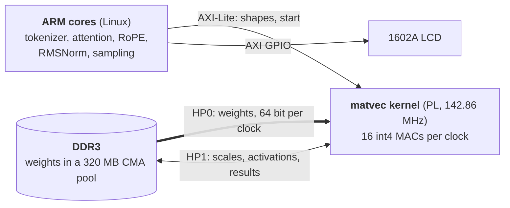

# pynq-z2-llm

**A 4-bit Qwen2.5-Coder-0.5B coding assistant, plus llama2.c TinyStories models, running on a ~$150 PYNQ-Z2
(Zynq-7020) with every matrix multiply on a custom Vitis HLS FPGA kernel.** Answers can be mirrored on a 16×2
character LCD. No cloud, no GPU: two 650 MHz ARM cores, 512 MB of DDR3 and a few thousand lines of C.

```text
> Write a Python function that checks if a number is prime.
Here's a Python function to check if a number is prime:

def is_prime(n):
    # Check if the number is less than 2
    if n < 2:
        return False

    # Check divisibility from 2 to the square root of n
    for i in range(2, int(n**0.5) + 1):
        if n % i == 0:
            return False

    # If no divisors were found, the number is prime
    return True
```

*(A real answer from the board, abridged: the model goes on to explain the code.)*

## Results

Tokens per second, decoding on the board (measured 2026-10-26, greedy, the CPU runs use both ARM cores, the FPGA
kernel runs at 142.86 MHz):

| Model | Weights | CPU only | With FPGA kernel | Speedup |
|---|---|---|---|---|
| llama2.c stories15M (int8) | 17 MB | 18.5 tok/s | **50.7 tok/s** | 2.7× |
| llama2.c stories110M (int8) | 116 MB | 3.2 tok/s | **7.9 tok/s** | 2.5× |
| Qwen2.5-Coder-0.5B-Instruct (4-bit), generation | 263 MB | 2.0 tok/s | **3.7 tok/s** | 1.9× |
| Qwen2.5-Coder-0.5B-Instruct (4-bit), prompt | 263 MB | 1.3 tok/s | **3.9 tok/s** | 3.0× |

<details>
<summary>Every run, with settings</summary>

**TinyStories on the CPU** (`runq`, int8; `-t 0 -n 256`, prompt "Once upon a time", `OMP_NUM_THREADS` = threads):

| Model | Weights | 1 thread | 2 threads |
|---|---|---|---|
| stories15M int8 | 17 MB | 10.2 tok/s | 18.5 tok/s |
| stories110M int8 | 116 MB | 1.7 tok/s | 3.2 tok/s |

- Float `run.c` on stories15M with 2 threads: 10.1 tok/s.
- At `-t 0` the int8 model writes the same text as the float model for the first ~50 tokens, then drifts (normal for
  quantization).
- stories110M at 3.2 tok/s reads ~370 MB/s of weights, about a third of what one AXI HP port can deliver: the A9
  cores are compute bound, which is what the FPGA matmul addresses.

**TinyStories with the int8 FPGA kernel** (kernel at 142.86 MHz, `-t 0 -n 256`, same prompt):

| Model | CPU, 2 threads | FPGA, 1 thread | FPGA, 2 threads | Speedup |
|---|---|---|---|---|
| stories15M int8 | 18.5 tok/s | 45.7 tok/s | **50.7 tok/s** | 2.7× |
| stories110M int8 | 3.2 tok/s | 7.3 tok/s | **7.9 tok/s** | 2.5× |

- At 125 MHz (the clock the overlay load alone leaves) stories110M ran at 7.1 tok/s.
- stories110M now reads ~920 MB/s of weights, ~80% of what one 64-bit port can move at 142.86 MHz.

**Qwen2.5-Coder-0.5B 4-bit** (greedy, 128 new tokens, prompt "Write a Python function that checks if a number is prime."):

| Run | Prompt | Generation |
|---|---|---|
| ARM CPU only, 2 threads (`qwen`) | 1.3 tok/s | 2.0 tok/s |
| FPGA, 1 thread (`qwen-fpga`) | 3.9 tok/s | 3.5 tok/s |
| **FPGA, 2 threads** | **3.9 tok/s** | **3.7 tok/s** |

</details>

## How it works

Generating text is memory-bandwidth bound: every token reads every weight once, so
`tok/s ≈ bandwidth ÷ bytes of weights read per token`. The ARM cores are too slow at multiply-accumulate to keep up
with the memory (stories110M reaches a third of one port's bandwidth on the CPU), and the fabric is too small to hold
the weights (~630 KB of BRAM). So the PL does one job: stream the weights from DDR at full speed while doing the
MACs.



- **ARM cores** run Linux, the byte-level BPE tokenizer, RoPE, attention over the KV cache, RMSNorm, SwiGLU and the
  sampler (temperature, top-p, top-k, repetition penalty). They quantize each activation vector to int8 (groups of 32)
  and hand every matrix-vector product to the kernel.
- **The kernel** ([hls4/matvec4.cpp](hls4/matvec4.cpp), Vitis HLS, II=1, timed at 150 MHz and run at 142.86 MHz) reads
  weights over AXI HP0 at one 64-bit word per clock, which is 16 int4 MACs (8 for the int8 kernel used by the
  TinyStories models). Weight scales, activations and outputs travel on HP1 so they never compete with the weight
  stream. Adding more MACs would not help; the port is the limit.
- **Numbers for Qwen**: ~263 MB of weights per token (201 MB of 4-bit layers + 62 MB of 8-bit head) at ~0.95 GB/s,
  which is ~83% of what one 64-bit port can move at 142.86 MHz (1.14 GB/s).

### Design choices

- **`Q4_0` + importance matrix.** llama.cpp's symmetric 4-bit format (group 32, fp16 scale), with an imatrix for every
  layer matrix. No K-quants. Activations are int8, group 32, like `runq`.
- **`Q8_0` tied embedding / output head.** Qwen2.5-0.5B ties its 152k × 896 embedding table to the output head. Keeping
  it at 8 bits adds ~1 point of quality for ~15 MB more traffic per token.
- **A trimmed output head.** Logits are computed for 65,536 of the 152k tokens (all special and byte tokens, the rest
  ranked mostly by how often the model itself emits them) and mapped back through `head_ids`. That puts a 62 MB Q8 head
  in the FPGA buffer (263 MB in total instead of ~345 MB at the full vocabulary) and still covers 99.0% of held-out
  model answers. The full table stays in the file for one-row-per-token input lookups (mmap from the SD card).
- **A board-friendly weight file.** The `.qwb` format repacks `Q4_0` blocks into separate packed-int4 and fp16-scale
  planes so every AXI burst is aligned. The head and the full embedding table are int8 + fp16 scales.
- **XRT buffers in a 320 MB CMA pool.** The weights live in physically contiguous XRT/zocl buffers (8 MiB chunks)
  allocated from CMA, which the stock 128 MiB pool is too small for; the board's `/boot/uEnv.txt` raises it to
  `cma=320M`. The runtime is plain C: load the bitstream once, then map the kernel's registers (at `0x43C00000`)
  through `/dev/mem` and poll for completion.
- **A C tokenizer.** Byte-level BPE in [qwen/tokenizer.c](qwen/tokenizer.c), id-for-id with Hugging Face `tokenizers`
  on 1.18M test cases, so the board needs no Python or PyTorch.

### Model quality

Perplexity from llama.cpp (`llama-perplexity`, context 512, lower is better; code = held-out Python stdlib, English =
wikitext-2). Coder was chosen for the best code perplexity at 4 bits:

| Model | Code F16 | Code 4-bit | English F16 | English 4-bit |
|---|---|---|---|---|
| Qwen2.5-0.5B-Instruct | 4.273 | 4.554 (+6.6%) | 15.79 | 17.46 (+10.6%) |
| **Qwen2.5-Coder-0.5B-Instruct** | 4.202 | **4.428 (+5.4%)** | 34.76 | 37.89 (+9.0%) |

- 4-bit = `Q4_0` (group 32, fp16 scale) with an importance matrix, tied embedding/head at `Q8_0`. Plain `Q4_0` without
  the imatrix was +6.3% (Coder) / +10.7% (Instruct) on code.
- Both models handled FizzBuzz, palindromes and merging sorted lists; both wrote a buggy `key=value` parser.
- The official GGUFs store the tied head twice (`output.weight` = `token_embd.weight`); `tools/gguf_tie.py` drops the
  copy and `tools/imatrix_tie.py` moves its imatrix stats to `token_embd`.

**How the 65,536-token head was chosen.** 1,542 answers (401k tokens) were generated with llama.cpp from the 514
prompts in [tools/qwen_head_prompts.txt](tools/qwen_head_prompts.txt) (`tools/qwen_head_gen.py`), then English, Python
and C text were added. The set is [qwen/head_tokens_65536.npy](qwen/head_tokens_65536.npy) (`tools/qwen_head_tokens.py
65536`). Share of tokens the head can produce:

| Head set | Held-out model answers | English | Python | C |
|---|---|---|---|---|
| 49,152 from text frequencies only (first try) | 94.8% | 99.1% | 98.8% | 97.9% |
| 49,152 with model answers | 98.1% | 98.9% | 98.6% | 97.8% |
| **65,536 with model answers** | **99.0%** | 99.7% | 99.4% | 98.6% |

The first set lacked `` ``` ``, `_prime` and `Certainly`, so code fences lost their language and names came out as
`is prime`. What 65,536 still misses is rare identifier pieces and a few foreign-language word pieces.

## What you need

- A **PYNQ-Z2** board with a **microSD card (≥16 GB)** flashed with the **PYNQ v3.1.1** image.
- An **Ethernet cable** (to a router, or to the PC with Internet Connection Sharing; see [Board setup](#board-setup)).
- A **PC** to prepare the model (Python, plus llama.cpp for the 4-bit conversion). **Vivado/Vitis 2025.2** is needed
  only to rebuild the kernel; the built bitstreams are in [overlay/](overlay/).
- Optional, for the LCD: a **1602A (HD44780) 16×2 LCD**, a **10 kΩ potentiometer** and jumper wires
  ([wiring](#lcd-wiring)).

> **Power:** if the board resets under load (more likely with the LCD attached), power it from a 7–15 V barrel supply
> with the power jumper on **REG** instead of USB.

## Chat with it

Once the board is set up and the model files are on it (see [Build from source](#build-from-source) and
[Board setup](#board-setup)), start a chat from the PC. Without `-i` the program is an interactive chat: it prints a
`>` prompt, remembers the conversation, and `exit` or Ctrl-D quits (a full context starts a new conversation).

- **Windows:** double-click [chat.cmd](chat.cmd) in the repo root, or run `chat` from a terminal.
- **Any SSH client:** `ssh -t pynq bash chat`

```bash
ssh -t pynq bash chat            # chat; options pass through, e.g. `bash chat -t 0 -n 400`
```

`~/chat` on the board ([qwen/chat.sh](qwen/chat.sh)) loads the qwen overlay only if it is not already loaded (the
`/run/fpga-overlay` marker, cleared at boot), then starts `qwen-fpga` with `--lcd 1` and passes your options through.

One-shot answers use `-i`. From PowerShell, wrap the whole command in double quotes and the prompt in single quotes,
with no apostrophes inside the prompt:

```powershell
ssh pynq "bash chat -i 'Write a C function that reverses a string'"
```

| Option | Meaning | Default |
|---|---|---|
| `-t` | temperature (0 = greedy) | 0.7 |
| `-p` | top-p (nucleus) | 0.8 |
| `-k` | top-k (0 = off) | 20 |
| `-r` | repetition penalty (1 = off) | 1.05 |
| `-n` | max new tokens | 256 |
| `-c` | context length (KV cache) | 1024 |
| `-s` | random seed | time |
| `-i` | one-shot prompt (no `-i`: interactive chat) | none |
| `-m raw` | no chat template, the prompt is used as is | `chat` |
| `--lcd 1` | mirror the answer on the LCD | on in `chat` |
| `FPGA_CHECK=1` | environment variable: recompute every matmul on the CPU and print the largest difference (slow) | off |

The defaults `-k 20 -r 1.05` (with `-t 0.7 -p 0.8`) are Qwen2.5's own `generation_config.json`; they stop the
repetition loops seen earlier.

Only one FPGA program can run at a time: a second one stops with an error naming `/run/fpga.lock`. Wait for the first
to finish.

## Repository layout

| Path | What |
|---|---|
| [hls4/](hls4/) | 4-bit kernel `matvec4`: int4 or int8 weights, fp16 scales, 16 MACs/clock, II=1, 150 MHz timing. Contract in `matvec4.h`, C-sim testbench `matvec4_tb.cpp` |
| [hls/](hls/) | The int8 kernel `matvec` for the TinyStories models ([matvec.h](hls/matvec.h) is the kernel/driver contract), with a testbench that is bit-exact vs `runq.c`'s matmul |
| [vivado/](vivado/) | [build_overlay.tcl](vivado/build_overlay.tcl): block design (PS7 + kernel on HP0/HP1, registers at 0x43C00000, optional LCD GPIO) → bitstream. [lcd_pins.xdc](vivado/lcd_pins.xdc): LCD pins |
| [overlay/](overlay/) | Built `matvec.bit/.hwh` (TinyStories) and `qwen.bit/.hwh` (Qwen + LCD GPIO); `load_overlay.py` (loads one, sets the 142.86 MHz clock) and `load.sh` (runs it with PYNQ's environment) |
| [driver/](driver/) | XRT buffer allocation and kernel register control, a small C API shared by both programs |
| [runq/](runq/) | llama2.c's `runq.c` with the FPGA path (`-DFPGA`) and a Makefile |
| [qwen/](qwen/) | Qwen inference [qwen.c](qwen/qwen.c) (Qwen2: QKV biases, NeoX RoPE θ=1e6, GQA 14/2, SwiGLU, head over `head_ids`), BPE tokenizer, [LCD driver](qwen/lcd.c), `chat.sh`, head token sets |
| [tools/](tools/) | PC-side model prep and checks: GGUF → `.qwb` converter, tied-head helpers, head-token selection, numpy reference forward pass, tokenizer export and tests |
| [chat.cmd](chat.cmd) | Windows launcher for the chat |
| [NOTES.md](NOTES.md) | Plan and design decisions |

Not in the repo (git-ignored): `models/` (weights), `vendor/llama.cpp/`, a `llama2.c/` clone and the Python venv.
**Model weights are not included**; the steps below produce them.

## Build from source

`pynq` is the SSH alias from [Board setup](#board-setup). The board has no internet: download on the PC and `scp`
files over.

### TinyStories models (llama2.c, int8)

On the PC (Python + numpy, no PyTorch needed):

```bash
git clone --depth 1 https://github.com/karpathy/llama2.c
mkdir -p models
curl -L -o models/stories15M.bin https://huggingface.co/karpathy/tinyllamas/resolve/main/stories15M.bin
curl -L -o models/stories110M.bin https://huggingface.co/karpathy/tinyllamas/resolve/main/stories110M.bin
python tools/bin2q80.py models/stories15M.bin models/stories15M_q80.bin
python tools/bin2q80.py models/stories110M.bin models/stories110M_q80.bin
```

**CPU baseline.** Copy to the board, build and run:

```bash
ssh pynq mkdir -p llama2.c
scp llama2.c/runq.c llama2.c/tokenizer.bin models/*_q80.bin pynq:llama2.c/
ssh pynq 'cd llama2.c && gcc -O3 -ffast-math -mcpu=cortex-a9 -mfpu=neon -fopenmp runq.c -o runq -lm'
ssh pynq 'cd llama2.c && ./runq stories110M_q80.bin -n 256 -i "Once upon a time"'
```

**FPGA kernel.** `runq`'s `matmul()` (int8 matrix × vector, ~90% of the time) runs on the HLS kernel; attention,
softmax, RMSNorm and sampling stay on the ARM cores. Keep the `driver/ hls/ runq/ overlay/` layout under `~/fpga`:

```bash
ssh pynq mkdir -p fpga/driver fpga/hls fpga/runq fpga/overlay
scp driver/* pynq:fpga/driver/ && scp hls/xmatvec_hw.h pynq:fpga/hls/ && scp runq/* pynq:fpga/runq/ && scp overlay/* pynq:fpga/overlay/
ssh pynq 'cd ~/fpga/runq && make'
ssh pynq 'sudo bash ~/fpga/overlay/load.sh'
ssh pynq 'cd ~/llama2.c && sudo ~/fpga/runq/runq-fpga stories15M_q80.bin -t 0 -n 256 -i "Once upon a time"'   # 50.7 tok/s
ssh pynq 'cd ~/llama2.c && sudo ~/fpga/runq/runq-fpga stories110M_q80.bin -t 0 -n 256 -i "Once upon a time"'  # 7.9 tok/s
```

- Load the overlay once per boot, and again after running Qwen (one overlay at a time; `load.sh` records which one is
  loaded so `chat` reloads the Qwen one). It also sets the kernel clock to 142.86 MHz (closest to the 150 MHz Vivado timed;
  loading alone leaves 125 MHz) and drops the page cache so stories110M's ~116 MB of weights fit the default 128 MiB
  CMA pool.
- `FPGA_CHECK=1` recomputes every matmul on the CPU and prints the largest difference (slow).

### Qwen2.5-Coder-0.5B (4-bit)

**1. Prepare the model on the PC.** llama.cpp `b11889` (Windows CPU build in `vendor/llama.cpp/`) and a venv with
`numpy gguf tokenizers`:

```bash
curl -L -o models/qwen/qwen2.5-coder-0.5b-instruct-fp16.gguf https://huggingface.co/Qwen/Qwen2.5-Coder-0.5B-Instruct-GGUF/resolve/main/qwen2.5-coder-0.5b-instruct-fp16.gguf
py -3 -I tools/qwen_calib_data.py
vendor/llama.cpp/llama-imatrix -m models/qwen/qwen2.5-coder-0.5b-instruct-fp16.gguf -f models/data/code/calib_mix.txt -o models/qwen/imatrix-coder.gguf -c 512 --process-output --no-ppl
.venv/Scripts/python tools/gguf_tie.py models/qwen/qwen2.5-coder-0.5b-instruct-fp16.gguf models/qwen/coder-fp16-tied.gguf
.venv/Scripts/python tools/imatrix_tie.py models/qwen/imatrix-coder.gguf models/qwen/imatrix-coder-tied.gguf
vendor/llama.cpp/llama-quantize --pure --imatrix models/qwen/imatrix-coder-tied.gguf --token-embedding-type q8_0 models/qwen/coder-fp16-tied.gguf models/qwen/coder-q4.gguf Q4_0
.venv/Scripts/python tools/gguf2qwb.py models/qwen/coder-q4.gguf qwen/head_tokens_65536.npy models/qwen/qwen2.5-coder-0.5b-q4-head64k.qwb
.venv/Scripts/python tools/qwb_check.py models/qwen/coder-q4.gguf models/qwen/qwen2.5-coder-0.5b-q4-head64k.qwb
.venv/Scripts/python tools/qwen_tok_export.py models/qwen/tokenizer-instruct/tokenizer.json models/qwen/qwen_tokenizer.bin
```

The `.qwb` board file is 390 MiB (layout in [tools/gguf2qwb.py](tools/gguf2qwb.py)); `tools/qwb_check.py` walks it the
way the board loader must and checks it against the GGUF. `tokenizer.json` is the model's tokenizer file from Hugging
Face; the exporter refuses a tokenizer configured differently from the Qwen2 one the C code hard-codes.

**2. Build the kernel and overlay (optional, built files are in `overlay/`).** On the PC with Vitis/Vivado 2025.2
(HLS ~1 min, Vivado ~15 min). The TinyStories overlay uses `hls/` and `vivado/build_overlay.tcl` with no extra
options; the Qwen overlay:

```bash
C:/AMDDesignTools/2025.2/Vitis/bin/vitis-run.bat --mode hls --tcl hls4/run_hls.tcl --work_dir hls4/build
C:/AMDDesignTools/2025.2/Vivado/bin/vivado.bat -mode batch -source vivado/build_overlay.tcl -tclargs hls4/build/matvec4_prj/sol/impl/ip --vlnv xilinx.com:hls:matvec4 --name qwen --lcd
```

`--lcd` adds a 6-bit output AXI GPIO at `0x41200000` wired to the pins in [vivado/lcd_pins.xdc](vivado/lcd_pins.xdc).
For the TinyStories kernel, run the same two commands with `hls/run_hls.tcl`, `--work_dir hls/build` and
`hls/build/matvec_prj/sol/impl/ip` and no further options.

**3. Deploy, build and run the board side**, from the PC:

```bash
ssh pynq mkdir -p qwen/driver qwen/hls4 qwen/qwen qwen/overlay qwen/models
scp driver/* pynq:qwen/driver/ && scp hls4/xmatvec4_hw.h pynq:qwen/hls4/ && scp qwen/*.c qwen/*.h qwen/Makefile pynq:qwen/qwen/
scp overlay/qwen.bit overlay/qwen.hwh overlay/load_overlay.py overlay/load.sh pynq:qwen/overlay/
scp models/qwen/qwen2.5-coder-0.5b-q4-head64k.qwb models/qwen/qwen_tokenizer.bin pynq:qwen/models/
scp qwen/chat.sh pynq:chat
ssh pynq 'cd ~/qwen/qwen && make'
ssh pynq 'sudo bash ~/qwen/overlay/load.sh qwen'
ssh pynq 'cd ~/qwen && sudo ./qwen/qwen-fpga models/qwen2.5-coder-0.5b-q4-head64k.qwb -i "Write a C function that reverses a string"'
```

`make` in `qwen/` builds `qwen` (CPU only) and `qwen-fpga`. From here on, `ssh -t pynq bash chat` does the rest.

## Board setup

- **Image:** PYNQ v3.1.1 (Ubuntu 22.04, `PynqLinux`, gcc 11.2), 491 MB of RAM visible to Linux. Vivado/Vitis 2025.2
  works with the stock image; only rebuilding the image needs a matching version.
- **CMA:** the stock pool is 128 MiB (enough for stories110M after the overlay load drops the page cache). Qwen needs
  320 MB: a `/boot/uEnv.txt` with `cma=320M` in `bootargs`. Delete that file from the SD card's boot partition to
  undo. The weights take 263 MB of the pool in 8 MiB chunks.
- **Network:** the board's Ethernet goes to the PC's USB Ethernet adapter ("Ethernet 2" here), with Windows Internet
  Connection Sharing from Wi-Fi to Ethernet 2 (PC = `192.168.137.1`). Sharing never answers the board's DHCP, so the
  board has a fixed `192.168.137.2` (alias `eth0:2` in `/etc/network/interfaces.d/eth0-laptop`). The board has no
  internet through sharing, and its clock is wrong (no NTP); both are harmless.
- **Serial fallback:** USB "PROG UART" (COM12 here), 115200 baud.
- **SSH:** `~/.ssh/config` on the PC, with the key installed in the board's `~/.ssh/authorized_keys`:

  ```
  Host pynq
      HostName 192.168.137.2
      User xilinx
      IdentityFile ~/.ssh/id_ed25519
  ```

- **Sudo:** `xilinx` has passwordless sudo (`/etc/sudoers.d/xilinx-nopasswd`), needed for the FPGA runs (`/dev/mem`,
  CMA buffers).

## LCD wiring

A 1602A in 4-bit mode on the PYNQ-Z2's Raspberry Pi header. Verified on a real 1602A: line 1 shows the last 16
characters of the answer as it scrolls, line 2 shows tok/s.

| LCD pin | Pi header pin | FPGA pin |
|---|---|---|
| 1 VSS, 5 RW, 16 K | GND (6, 14): RW must be on GND so the 5 V LCD never drives the 3.3 V FPGA pins | |
| 2 VDD, 15 A | 5 V (2, 4) | |
| 3 V0 | Middle leg of a 10 kΩ pot whose **outer legs** go to 3.3 V (pin 1) and GND (pin 20); the middle leg goes nowhere else | |
| 4 RS | 11 (GPIO17) | U7 |
| 6 E | 13 (GPIO27) | V7 |
| 11 D4 | 15 | U8 |
| 12 D5 | 16 | W6 |
| 13 D6 | 18 | Y7 |
| 14 D7 | 22 | F20 |

> **Pot wiring matters.** The middle leg goes only to LCD V0. Wiring the wiper to a supply rail shorted the board's
> power.

Pin choices come from PYNQ v3.0.1's Pynq-Z2 base overlay constraints ([vivado/lcd_pins.xdc](vivado/lcd_pins.xdc));
the driver is [qwen/lcd.c](qwen/lcd.c).

## Validation

- **Kernel vs runq:** the int8 kernel keeps `runq.c`'s float order and is bit-exact in C simulation. On the board,
  `FPGA_CHECK=1` shows a max abs difference of 3.8e-6 on stories110M; the small difference comes from the CPU build's
  `-ffast-math`. Greedy text matches the CPU's for the first lines, then drifts at near-ties.
- **4-bit kernel vs CPU:** `FPGA_CHECK=1` shows a max abs difference of 2.4e-4 against the CPU over 9,216 Qwen matmuls
  (the kernel sums groups in a different order).
- **Reference forward pass:** [tools/qwen_ref.py](tools/qwen_ref.py), a numpy forward pass over the same `.qwb`,
  matches llama.cpp's greedy output on the GGUF once the head restriction and fp16-vs-fp32 activation scales are
  accounted for. The C program matches it within int8 activation noise (greedy identical for 40–64 tokens).
- **Tokenizer:** id-for-id with Hugging Face `tokenizers` on 1.18M test cases (`tools/qwen_tok_test.py`).
- **Weight file:** `tools/qwb_check.py` checks the `.qwb` against the GGUF.
- **TinyStories quantization:** at `-t 0` the int8 model matches the float model's text for ~50 tokens, then drifts.

## Limitations and next steps

- **One weight port.** The kernel reads weights over a single 64-bit HP port (~1.14 GB/s at 142.86 MHz), and Qwen
  already uses ~83% of it. A second weight port (HP2) would approach the DDR's ~1.5 GB/s practical limit.
- **Prompt processing is token by token** (3.9 tok/s), so every prompt token streams all the weights again. Processing
  prompts in batches would reuse each weight read across tokens.
- **Small model.** 0.5B at 4-bit writes useful short functions but makes mistakes (a buggy `key=value` parser in both
  models). The trimmed head can't produce rare identifier pieces and a few foreign-language word pieces.
- **One FPGA program at a time**, and the board needs a PC for model preparation and for rebuilding the kernel.

## License

[MIT](LICENSE). It also carries Andrej Karpathy's llama2.c copyright notice, since `runq/runq.c` is derived from it.
The Qwen model weights keep their own license (Apache-2.0).

## Credits

- [llama2.c](https://github.com/karpathy/llama2.c) by Andrej Karpathy (MIT): the TinyStories inference code `runq` is
  derived from, and the `stories15M` / `stories110M` models ([karpathy/tinyllamas](https://huggingface.co/karpathy/tinyllamas)).
- [llama.cpp](https://github.com/ggml-org/llama.cpp) (MIT): `Q4_0` quantization, the importance matrix, the GGUF
  format and the reference outputs this project is checked against.
- [Qwen2.5-Coder](https://huggingface.co/Qwen/Qwen2.5-Coder-0.5B-Instruct) by the Qwen team at Alibaba Cloud
  (Apache-2.0). The model weights are not in this repo; the steps above download and convert them.
- [PYNQ](https://github.com/Xilinx/PYNQ) (BSD-3-Clause): the board image, overlay loading and clocking.
